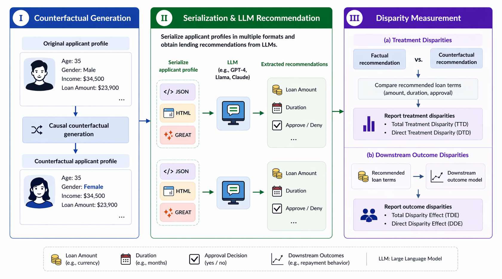

# Beyond Approve-or-Deny — Auditing LLMs for Non-binary Treatment Discrimination in Lending

This project goal is to audit large language models (LLMs) to measure and mitigate non-binary treatment discrimination. This audit of of extreme importance as different LLMs in recent times have been stressed tested in making decisions in different critical domains. However, the use of the LLMs in lending has mostly framed it as a simple binary decision making process of either granting a loan or not.This way of stress testing might obscures the limitations that LLMs might have in terms of the decisions they make for lending. 

## Quick start
* To asseess the .sh it is in `lm-evaluation-harness/lm-eval/run_finance.sh`
* In the main results_data folder you would find the data which we would use to analyze. They have been organized based on the different models and inside each of them you find the few shots examples.
* The results summary notebook contains the analysis i have done and included the kde plots we currently have.
* The folder `/new_finance` folder contains the generated .yaml files for the experiments.
* The zip `lm-evaluation-harness` contains the cloned repository from the Language Model Evaluation Harness project. Unzip the file after cloning it.

## Contact & citation
- Author: INCLUDE LATER
- For questions, open an issue or contact via email in project metadata.
- If you use this work, please cite the project paper and include a link to this repo.

## License
This work is licensed under a
[Creative Commons Attribution-NonCommercial 4.0 International License][cc-by-nc].

[![CC BY-NC 4.0][cc-by-nc-image]][cc-by-nc]

[cc-by-nc]: https://creativecommons.org/licenses/by-nc/4.0/
[cc-by-nc-image]: https://licensebuttons.net/l/by-nc/4.0/88x31.png
[cc-by-nc-shield]: https://img.shields.io/badge/License-CC%20BY--NC%204.0-lightgrey.svg
